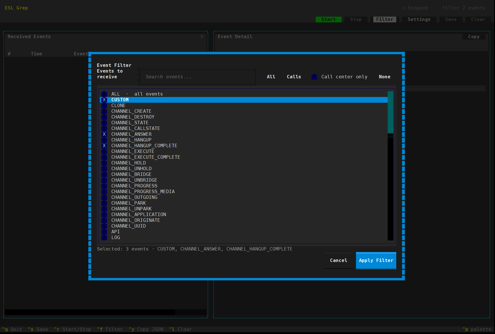

# ESL Grep

A terminal UI for watching FreeSWITCH ESL (Event Socket Library) events in real
time.

ESL Grep connects to FreeSWITCH's event socket, lets you subscribe to exactly
the events you care about, and shows each event as readable, syntax-highlighted
JSON. Captures can be saved as plain JSON, as raw ESL frames, or as JSON Lines
for later analysis.

The ESL client is implemented directly on top of `asyncio`, so **no C
extension, SWIG bindings, or `python-ESL` package is required**. It runs
wherever Python runs.

> **AI assistance:** This project was developed with the help of AI coding
> assistants. See [AI assistance](#ai-assistance) for details.

## Contents

- [Features](#features)
- [Requirements](#requirements)
- [Installation](#installation)
- [FreeSWITCH setup](#freeswitch-setup)
- [Usage](#usage)
- [Keyboard shortcuts](#keyboard-shortcuts)
- [Save formats](#save-formats)
- [Configuration](#configuration)
- [ESL client and operating system support](#esl-client-and-operating-system-support)
- [Troubleshooting](#troubleshooting)
- [Development](#development)
- [Project structure](#project-structure)
- [Appendix: installing the official `python-ESL` module](#appendix-installing-the-official-python-esl-module)
- [AI assistance](#ai-assistance)
- [License](#license)

## Features

- Connects to `127.0.0.1:8021` with the default password `ClueCon`
- Change host, port, and password from the in-app Settings screen
- Subscribe to all events (`ALL`) by default
- Search and multi-select FreeSWITCH event names in the Filter screen
  - Presets for all events, call-related events, and no events
  - Server-side subscription plus a client-side safety filter
  - Changes are saved and applied on the next Start
- Receive only `mod_callcenter` events (`CUSTOM callcenter::info`) with one
  checkbox
- Start and stop event reception without leaving the app
- Browse received events in a table and inspect the full JSON on the right
  - JSON syntax highlighting (tree-sitter)
  - Jump to a JSON key by typing its name
  - Call center events show their `CC-Action` value in the list
- Open the current event JSON in a full-screen copy view (`Copy` button or
  `Ctrl+Y`)
  - Everything behind the view is hidden, so terminal `Shift`+mouse drag can
    select only the JSON
  - `F2` toggles line wrapping without affecting the copied text
- Save the events received so far as `.json`, `.esl`, or `.jsonl`
- Clear the current event list after a confirmation
- Settings are stored in `~/.config/esl_grep/config.json` with mode `0600`
- Connection and authentication errors are shown in the status bar and as
  notifications


## Screenshot 

<br>



<br>


<br>

## Requirements

- Python **3.10 or newer**
- [uv](https://docs.astral.sh/uv/) (recommended), or `pip` with a virtual
  environment
- A running FreeSWITCH instance with `mod_event_socket` enabled for ESL access

Supported operating systems: Linux, macOS, and Windows (Windows Terminal or
another modern terminal). The app itself has no platform-specific code.

## Installation

### With uv (recommended)

```bash
git clone https://github.com/<your-account>/ESL_grep.git
cd ESL_grep
uv sync
```

Run the app:

```bash
uv run esl_grep
```

You can also run it as a module:

```bash
uv run python -m esl_grep
```

### With pip and a virtual environment

```bash
git clone https://github.com/<your-account>/ESL_grep.git
cd ESL_grep
python3 -m venv .venv
source .venv/bin/activate        # Windows: .venv\Scripts\activate
pip install -e .
esl_grep
```

### Updating

```bash
git pull
uv sync
```

## FreeSWITCH setup

ESL Grep needs the FreeSWITCH event socket module to be loaded.

1. Check that `mod_event_socket` is available:

   ```bash
   fs_cli -x "module_exists mod_event_socket"
   ```

2. Edit `conf/autoload_configs/event_socket.conf.xml`:

   ```xml
   <configuration name="event_socket.conf" description="Socket Client">
     <settings>
       <param name="nat-map" value="false"/>
       <param name="listen-ip" value="127.0.0.1"/>
       <param name="listen-port" value="8021"/>
       <param name="password" value="ClueCon"/>
       <!-- Restrict access when listening on a public interface. -->
       <!-- <param name="apply-inbound-acl" value="lan"/> -->
     </settings>
   </configuration>
   ```

3. Reload the configuration:

   ```bash
   fs_cli -x "reloadxml"
   ```

4. Verify the port is listening:

   ```bash
   ss -ltnp | grep 8021
   ```

> **Security:** Change the default `ClueCon` password before exposing ESL
> outside `localhost`, and use `apply-inbound-acl` to limit which hosts may
> connect.

## Usage

1. Open **Settings** and enter the ESL host, port, and password. Defaults are
   `127.0.0.1`, `8021`, and `ClueCon`.
2. Open **Filter** and choose the events to receive. The default is `ALL`.
   - Use **All**, **Calls**, or **None** for quick presets.
   - Type in the search box to narrow the event list.
   - Enable **Call center only** to receive only
     `CUSTOM callcenter::info` events. While this is enabled, the regular event
     selection is ignored.
3. Click **Apply**. Settings are saved immediately but do not disturb an active
   connection. Stop and start the stream (or restart the app) to apply them.
   While streaming with pending changes, the status bar shows
   `Settings changed (restart required)`.
4. Click **Start**. Received events appear in the left-hand table.
5. Select an event to view its JSON on the right.
6. Type a key name (for example `CC-Action`) into the key search box and press
   `Enter` to highlight the matching JSON line.
7. Click **Copy** or press `Ctrl+Y` to open the full-screen copy view. Select
   the JSON with `Shift`+mouse drag; the terminal copies the selection to the
   system clipboard. Press `Esc` to return.
8. Click **Save**, choose a path and format, and confirm. If the file already
   exists, ESL Grep asks before overwriting.

### Status bar

| Status | Meaning |
| --- | --- |
| `○ Stopped · Filter ALL` | No active connection |
| `◌ Connecting host:port` | TCP connection and authentication in progress |
| `● Receiving host:port · N events · FILTER` | Streaming events |
| `● Error ...` | Connection, authentication, or protocol failure |

## Keyboard shortcuts

| Shortcut | Action |
| --- | --- |
| `Ctrl+R` | Start or stop event reception |
| `Ctrl+F` | Open the event filter |
| `Ctrl+Y` | Open the full-screen JSON copy view |
| `Ctrl+S` | Save received events |
| `Ctrl+L` | Clear the event list |
| `Ctrl+Q` | Quit |
| `Space` | Toggle an event in the filter/settings list |
| `Esc` | Close the current dialog |
| `F2` | Toggle line wrapping in the copy view |

## Save formats

The default file name is `esl_capture_YYYYMMDD_HHMMSS.json`.

### `.json` (default)

Saves only the JSON shown in the event detail pane, as one JSON array. Wrapper
metadata such as receive time and raw frames is not included.

```json
[
  {
    "Event-Name": "RELOADXML",
    "...": "..."
  },
  {
    "Event-Name": "CHANNEL_CREATE",
    "...": "..."
  }
]
```

### `.esl`

Concatenates the original `Content-Length`-delimited ESL frames exactly as they
were received. This is useful for replaying or analysing a capture with ESL
tools.

```text
Content-Length: 483
Content-Type: text/event-json

{"Event-Name":"RELOADXML", "...": "..."}
Content-Length: 512
Content-Type: text/event-json

{"Event-Name":"CHANNEL_CREATE", "...": "..."}
```

### `.jsonl`

Writes one structured record per line, including receive time, event headers,
body, and the raw packet.

```json
{"received_at":"2026-11-06T12:29:00+09:00","event":"RELOADXML","subclass":"","content_type":"text/event-json","headers":{},"body":"{...}","raw":"Content-Length: ..."}
```

## Configuration

Settings are stored in:

```text
$XDG_CONFIG_HOME/esl_grep/config.json
# or, when XDG_CONFIG_HOME is unset:
~/.config/esl_grep/config.json
```

The file is written atomically with owner-only permissions (`0600`). Example:

```json
{
  "version": 1,
  "host": "127.0.0.1",
  "port": 8021,
  "password": "ClueCon",
  "events": ["ALL"],
  "callcenter_only": false
}
```

Invalid or unreadable configuration files fall back to safe defaults.

## ESL client and operating system support

FreeSWITCH's official `python-ESL` bindings are a C extension built with SWIG.
Prebuilt packages are often tied to one distribution and Python ABI; many
tutorials target Rocky Linux 8 and its system Python.

ESL Grep avoids that problem entirely. `src/esl_grep/esl.py` implements the
inbound ESL protocol in pure Python:

- TCP connection to the event socket
- `auth <password>` handshake
- `event json` subscription, including `CUSTOM callcenter::info`
- `Content-Length` frame parsing
- Event JSON decoding and raw frame preservation

Because there is no compiled dependency, the same code runs on:

| Platform | Notes |
| --- | --- |
| Rocky Linux 8 / RHEL / AlmaLinux | Works with Python 3.10+ (for example from AppStream, pyenv, or uv) |
| Other Linux distributions | Works with the distribution's Python 3.10+ |
| macOS | Works with Homebrew Python 3.10+ |
| Windows | Works in Windows Terminal; use WSL if you prefer a Linux environment |

The only server-side requirement is `mod_event_socket`. If you want to use
another language or the official bindings elsewhere, see the
[appendix](#appendix-installing-the-official-python-esl-module).

### Using the ESL client as a library

`esl.py` has no TUI dependencies and can be reused on its own:

```python
import asyncio

from esl_grep.esl import EslClient


async def main() -> None:
    client = await EslClient.connect("127.0.0.1", 8021, "ClueCon")
    try:
        await client.subscribe(("CHANNEL_CREATE", "CHANNEL_HANGUP_COMPLETE"))
        async for event in client.events():
            print(event.display_name, event.header("Unique-ID"))
    finally:
        await client.close()


asyncio.run(main())
```

## Troubleshooting

### `Connection refused` or `Connection timed out`

- Confirm FreeSWITCH is running: `fs_cli -x "status"`.
- Confirm `mod_event_socket` is loaded:
  `fs_cli -x "module_exists mod_event_socket"`.
- Check the listen address and port in `event_socket.conf.xml` and with
  `ss -ltnp | grep 8021`.
- If the server is remote, make sure the firewall allows the ESL port and that
  the ESL ACL permits your address.

### `ESL authentication failed`

- The password in Settings must match `event_socket.conf.xml`.
- Reload the configuration after changing it: `fs_cli -x "reloadxml"`.

### Connected, but no events appear

- Use `ALL` or the **Calls** preset to rule out an overly narrow filter.
- Generate traffic with a test call, or reload XML:
  `fs_cli -x "reloadxml"`.
- For call center events, verify that `mod_callcenter` is loaded and that
  **Call center only** is either enabled deliberately or disabled.

### Call center events do not appear

`mod_callcenter` publishes queue, agent, and tier updates as
`CUSTOM callcenter::info`. Enable **Call center only** to subscribe to that
stream, or select `CUSTOM` in the regular event list.

### The UI looks garbled on Windows

Use Windows Terminal (or another terminal with Unicode and true-color support).
Legacy `cmd.exe` consoles may not render the interface correctly.

## Development

Run the test suite:

```bash
uv run python -m unittest discover -s tests -v
```

Compile-check the sources:

```bash
uv run python -m compileall -q src
```

The test suite includes unit tests for frame parsing, configuration, capture
formats, and the UI, plus integration tests against a fake ESL server.

## Project structure

```text
ESL_grep/
  pyproject.toml
  README.md
  src/esl_grep/
    __init__.py    Package metadata
    __main__.py    python -m esl_grep entry point
    app.py         Textual application, streaming, and capture flow
    esl.py         Asyncio-based ESL protocol client
    config.py      Settings model and config file I/O
    events.py      FreeSWITCH event name catalog
    capture.py     JSON, raw ESL, and JSON Lines encoders
    screens.py     Settings, save, confirm, and copy modal screens
    theme.py       TextArea theme for the event detail and copy views
    app.tcss       Main screen styles
  tests/
    test_esl_grep.py      Unit and UI tests
    test_integration.py   Streaming tests against a fake ESL server
```

The Python package keeps the lowercase name `esl_grep` (the Python convention)
even though the repository is named `ESL_grep`.

## Appendix: installing the official `python-ESL` module

**This is not required by ESL Grep.** It is documented only for users who need
the official SWIG bindings for other tools. Prebuilt `python-ESL` packages are
frequently distributed for Rocky Linux 8 and may not exist for your OS or
Python version. In that case, build the module from the FreeSWITCH source tree.

### 1. Install build dependencies

Rocky Linux 8 / RHEL / AlmaLinux:

```bash
sudo dnf install -y git make gcc swig python3-devel
```

Debian / Ubuntu:

```bash
sudo apt update
sudo apt install -y git make gcc swig python3-dev python3-venv
```

macOS (Homebrew):

```bash
brew install git make swig python
```

Windows: use WSL2 and follow the Debian/Ubuntu steps. Native Windows builds of
`python-ESL` are not supported by the upstream project.

### 2. Build and install

Use the same Python interpreter that will run your application:

```bash
git clone https://github.com/signalwire/freeswitch.git
cd freeswitch/libs/esl
make pymod
sudo make pymod-install
```

If the build cannot find the intended interpreter, pass it explicitly:

```bash
make pymod PYTHON=python3.12
sudo make pymod-install PYTHON=python3.12
```

For a virtual environment, install into that environment rather than system
site-packages:

```bash
source /path/to/venv/bin/activate
make pymod
make pymod-install
```

### 3. Verify

```bash
python3 -c "import ESL; print(ESL.__file__)"
```

A quick connection test:

```python
import ESL

connection = ESL.ESLconnection("127.0.0.1", "8021", "ClueCon")
print(connection.connected())
```

### Why it often works only on Rocky Linux 8

The SWIG-generated module links against a specific Python ABI and naming
scheme (for example `python3.6` on Rocky 8). A binary built for the system
Python will not import into Python 3.11 or 3.12. Building `pymod` against the
exact interpreter you use avoids this problem on any operating system.

## AI assistance

This project was created with substantial assistance from AI coding tools.
AI was used for code generation, refactoring, user-interface text, tests, and
this documentation. The maintainer reviewed the generated code and ran the
test suite, including integration tests against a simulated ESL server.

AI-generated code can contain mistakes. Please review the source, run the
tests, and report any problems you find.

## Disclaimer

ESL Grep is an independent tool and is not affiliated with or endorsed by
SignalWire or the FreeSWITCH project. FreeSWITCH and SignalWire are trademarks
of their respective owners.

## License

This project was cloned from <https://github.com/raspberry-pi-maker>.

All other code and documentation are released under the MIT License. See
[LICENSE](LICENSE) for the full text.
